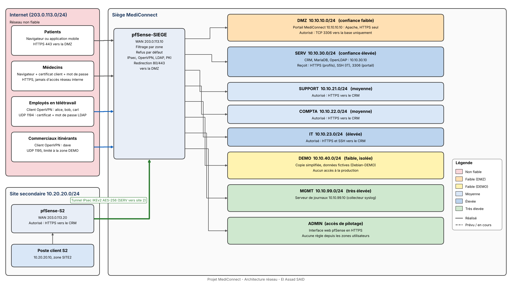

# MediConnect - Sécurisation réseau d'une plateforme de rendez-vous médicaux

Projet de sécurité des réseaux réalisé en binôme à l'**Efrei Paris** (I2, majeure Cybersécurité & Cloud), cours de M. Salim Benayoune, 2026-2027.

**Auteurs :** El Assad SAID et Yves de KERROS

MediConnect est une société fictive qui exploite une plateforme de prise de rendez-vous médicaux. Le projet consiste à concevoir, déployer et tester la sécurité réseau de son infrastructure sur une **maquette VMware** : deux sites, une plateforme exposée sur Internet, une zone de démonstration séparée de la production et cinq populations d'utilisateurs (patients, médecins, employés en télétravail, commerciaux itinérants, administrateurs). L'application elle-même n'est pas développée : un serveur Apache joue le rôle du portail.

## Rapport

Le rapport complet (architecture, plan d'adressage, zones, niveaux de confiance, VPN, authentification, filtrage, identité, contrôle applicatif, DMZ, administration, journalisation, tests, limites) est dans [`Rapport-MediConnect.pdf`](Rapport_MediConnect.pdf).

## Architecture

## Ce qui a été mis en place

| Domaine | Réalisation |
|---|---|
| Segmentation | Pare-feu **pfSense CE 2.9.0** : 9 interfaces (WAN, DMZ, SERV, DEMO, MGMT, SUPPORT, COMPTA, IT, ADMIN), règles évaluées à l'entrée de chaque interface, **refus par défaut**, alias lisibles |
| Site à site | Tunnel **IPsec IKEv2** (AES-256, SHA-256, DH 14, clé pré-partagée) limité au réseau serveurs et au site secondaire |
| Télétravail | **OpenVPN** (UDP 1194) : certificat client + mot de passe **LDAP**, Strict User-CN, adresse VPN fixe par utilisateur |
| Commerciaux | Second serveur **OpenVPN** (UDP 1195) limité à la zone DEMO par **deux barrières** : route annoncée unique et règle de pare-feu journalisée |
| Identité | Politique par profil (support, compta, IT, commerciaux) via adresses fixes et alias |
| Médecins | Site professionnel en **mTLS** (certificat client signé par l'autorité interne) puis mot de passe |
| PKI et annuaire | Autorité de certification interne (MediConnect-CA), **OpenLDAP** pour les comptes et groupes |
| DMZ | Portail en HTTPS seul, seul le port 3306 est ouvert vers la base, compte SQL à droits minimaux, sorties bloquées et journalisées |
| Administration | Interface web en HTTPS uniquement, SSH désactivé, aucun accès depuis les zones utilisateurs ni depuis les VPN |
| Journalisation | Envoi syslog (UDP 514) vers un serveur dédié en zone MGMT, avec un petit collecteur Python en service systemd |
| Tests | Nmap depuis Internet, tests de ports par zone et par profil VPN, vérification des journaux |

## Plan d'adressage

| Réseau | Adresses |
|---|---|
| Internet simulé | 203.0.113.0/24 |
| DMZ | 10.10.10.0/24 |
| SUPPORT / COMPTA / IT | 10.10.21.0/24, 10.10.22.0/24, 10.10.23.0/24 |
| SERV | 10.10.30.0/24 |
| DEMO | 10.10.40.0/24 |
| MGMT | 10.10.99.0/24 |
| Site secondaire | 10.20.20.0/24 |
| VPN télétravail | 10.99.10.0/24 |
| VPN commerciaux | 10.99.20.0/24 |

## Limites connues

- LDAP en clair (port 389), sans LDAPS ni STARTTLS.
- Contrôle applicatif par ports et protocoles : pas d'IDS/IPS ni de pare-feu applicatif.
- Clé pré-partagée IPsec : des certificats seraient préférables.
- Collecteur de journaux minimal (UDP non chiffré, sans rotation) ; journaux du site 2 non centralisés.
- Administration provisoire via une interface NAT VMware, mots de passe de maquette.
- Pas de haute disponibilité, maquette à échelle réduite.

Le détail et les justifications figurent dans le rapport.

## Technologies

pfSense, IPsec (IKEv2), OpenVPN, OpenLDAP, OpenSSL (PKI), Apache (mTLS), MariaDB, Debian, Kali Linux, Nmap, VMware Workstation.

## Remarque

Tous les noms, adresses, comptes et données sont **fictifs** et propres à la maquette. Aucun secret (certificat, clé privée, mot de passe) n'est publié dans ce dépôt.
